# OmniPanel

**An open-source data workspace for business analytics and enterprise agents.**

Bring orders, content performance, and creator partnerships into one place. Explore dashboards or use **WorkBuddy enterprise agents** to query authorized data, generate weekly reports, and initiate collector login repair. OmniPanel handles ingestion, metric definitions, and access auditing.

[](https://github.com/Nanboy-Ronan/OmniPanel/actions/workflows/ci.yml)
[](LICENSE)

**English** · [简体中文](README.zh-CN.md)

[System overview](#system-overview) · [WorkBuddy and other agents](#workbuddy-and-other-enterprise-agents) · [Try the preview](#try-the-preview) · [Self-host](#self-host) · [Documentation](#documentation)

## Recent updates

- **2026-10-17** — Hardened WorkBuddy (rate limits, revocation, report alerts and regeneration), added a confirmation code and immediate collect to login repair, and kept per-day media metric history with a raw file archive. [Feature commit](https://github.com/Nanboy-Ronan/OmniPanel/commit/c51257a)
- **2026-10-14** — Added WorkBuddy integration: read-only MCP queries, OAuth authorization, queued weekly reports, and owner-approved collector login repair. [Feature commit](https://github.com/Nanboy-Ronan/OmniPanel/commit/91e7b05)
- **2026-10-10** — Refreshed interactions, login approval, SQL isolation, audit logging, order/refund rules, and backup recovery. [Feature commit](https://github.com/Nanboy-Ronan/OmniPanel/commit/6c9e41a)
- **2026-10-05** — Migrated to React + TypeScript, with commerce BI, content and partnership analytics, and database status panels. [Feature commit](https://github.com/Nanboy-Ronan/OmniPanel/commit/02128cb)

## System overview

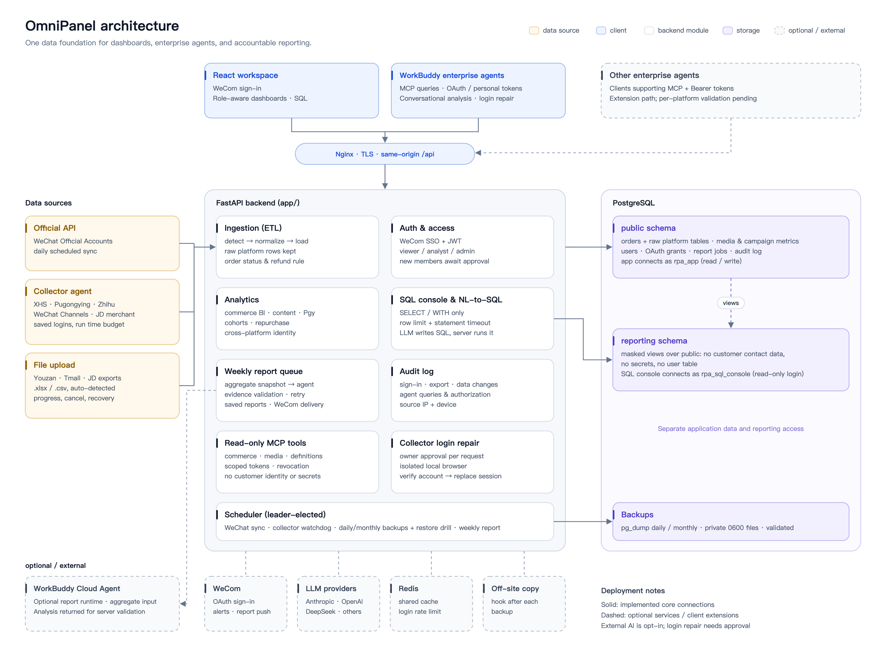

Solid lines show implemented core connections; dashed lines show optional services or client extensions pending validation. External AI is opt-in, and login repair requires user approval. See the [architecture guide](docs/architecture.md) for deployment details.

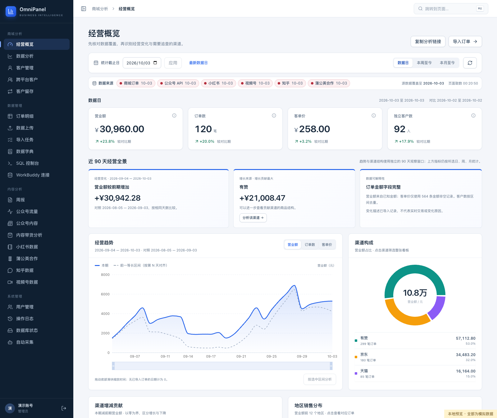

*Every screenshot uses synthetic demo data. No production accounts, credentials, or business exports are included.*

## From platform exports to useful answers

OmniPanel is built for teams that sell across marketplaces and publish across content platforms. It handles platform-specific import formats, order normalization, duplicate detection, and analytics in the same application.

| Your question | Where to start |
|---|---|
| How are sales changing, and which channels or products contribute? | Commerce dashboard with period comparisons, channel mix, product rankings, and regional breakdowns |
| Who returns, and how often? | Customer profiles, monthly retention cohorts, and cross-platform matching with separate exact and fuzzy results |
| Which content gets attention and engagement? | Content distributions, publishing trends, account metrics, and audience sources |
| How are creator partnerships performing? | Pugongying campaign and creator comparisons, spend, reach, and interaction costs |
| What changed this week? | Saved weekly reports across commerce and content, with coverage warnings and optional commentary |
| Can I investigate further? | Read-only SQL, natural-language queries, or scoped WorkBuddy tools |

Revenue follows shared order-status and refund rules. Dashboards distinguish data coverage from import time; incomplete periods remain visible. Content-to-sales views show associations, while exact and fuzzy customer matches remain separate.

## WorkBuddy and other enterprise agents

### Implemented: WorkBuddy

WorkBuddy provides a conversational entry point to the data OmniPanel has already normalized:

| Capability | Implementation |
|---|---|
| Query commerce and content performance | MCP tools expose aggregate metrics, media detail, definitions, freshness, and source links |
| Authorize each user | OAuth with PKCE or personal tokens, scoped access, revocation, and auditing |
| Generate weekly reports | OmniPanel sends aggregate snapshots to WorkBuddy Cloud Agent, queues work, validates evidence references, saves reports, and delivers notifications when configured |
| Repair collector login | An owner approves the request, signs in through an isolated local browser, and the platform verifies the account before updating its session |

Ask, for example: “Compare last week's channel sales and state the data coverage,” or “Analyze content by account, separating cumulative metrics from period gains.” Read-only tools do not expose customer identity fields, collector credentials, or arbitrary SQL.

[Configure WorkBuddy →](docs/workbuddy-integration.md)

### Extensible: other enterprise agents

**Yes—other agents can be integrated, with different work required for each capability.** The query service uses Streamable HTTP MCP and accepts Bearer personal tokens. Clients supporting both can attempt to reuse the existing endpoint:

```text
https://<your-domain>/api/integrations/workbuddy/mcp
```

| Integration goal | Existing foundation and remaining work |
|---|---|
| Query data from another MCP agent | Reuse the tools and personal tokens; validate transport, headers, Host/Origin checks, permissions, and revocation with that client |
| Add another platform's OAuth connection | Current callback rules target WorkBuddy and loopback addresses; add exact callback rules and test the new authorization flow |
| Use another agent to generate reports | Add a provider adapter while retaining snapshots, queueing, evidence validation, and delivery controls; MCP support alone does not replace the report runtime |
| Run login repair from another platform | Adapt its local tool or skill environment while preserving per-request approval and account verification |

Other enterprise agent products have not been validated end to end and are not listed as supported integrations. The endpoint currently retains its `workbuddy` name. Start with the [personal-token configuration template](integrations/workbuddy/mcp.example.json).

Separately, [natural-language SQL](docs/nl-to-sql.md) uses a configured model provider to generate SQL and a dedicated read-only database login to execute it. AI features require configuration and send their respective inputs to the selected provider when enabled.

## Explore the workspace

| Commerce analytics | Content performance |
|---|---|
| 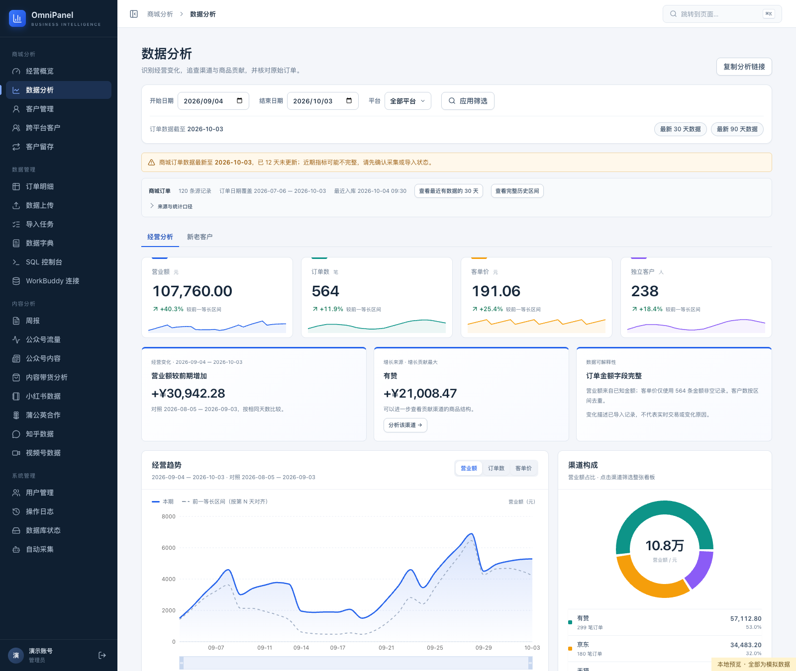 | 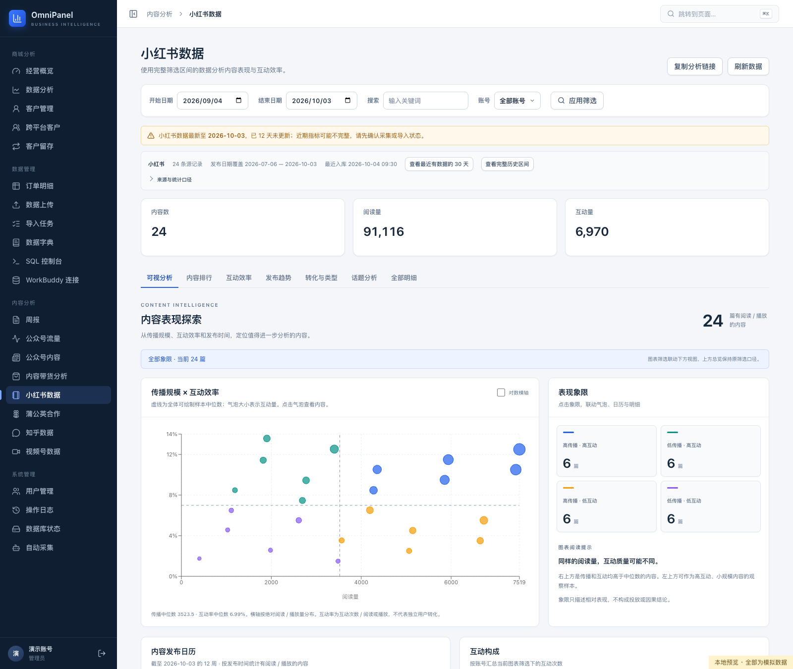 |

| Creator partnerships | WorkBuddy connection |
|---|---|
| 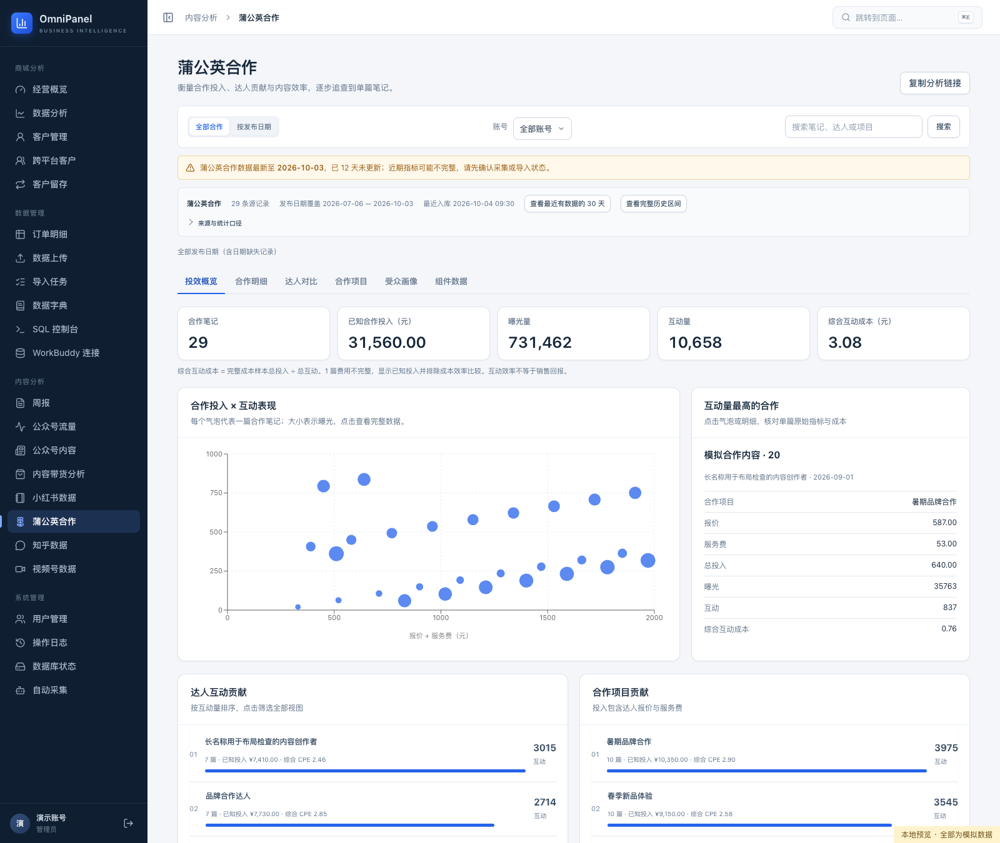 | 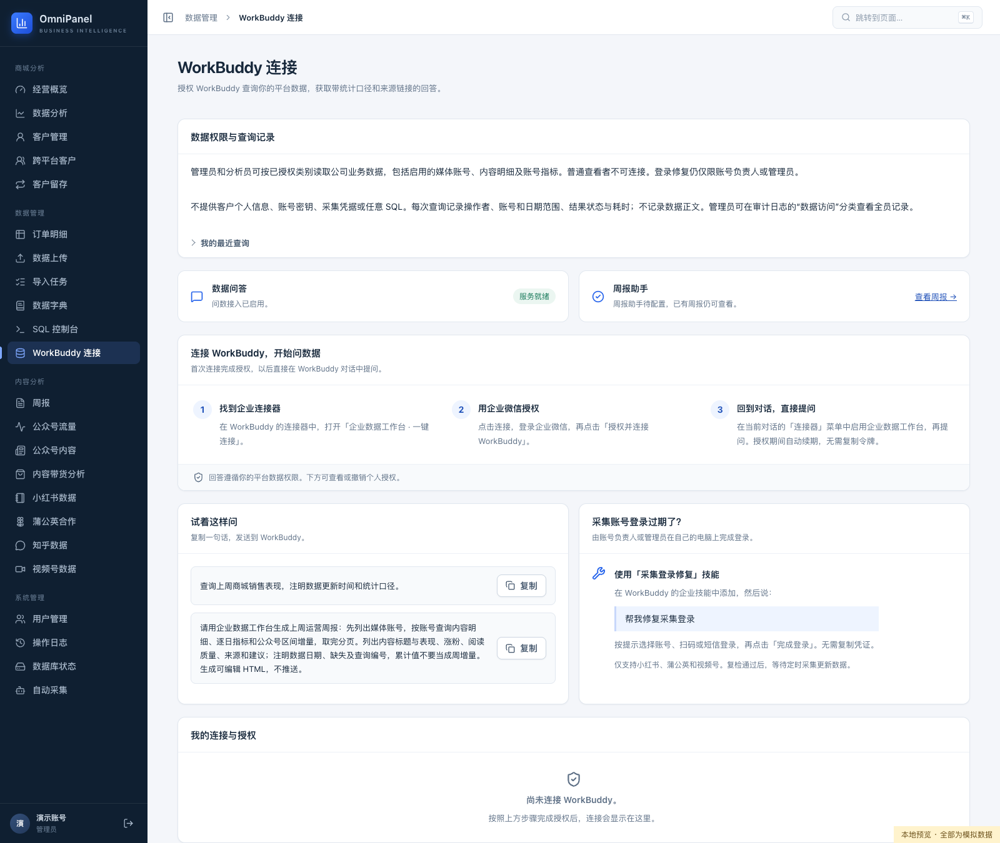 |

<details>
<summary>Customer retention, identity matching, SQL, and operations</summary>

| Customer retention | Cross-platform customers |
|---|---|
| 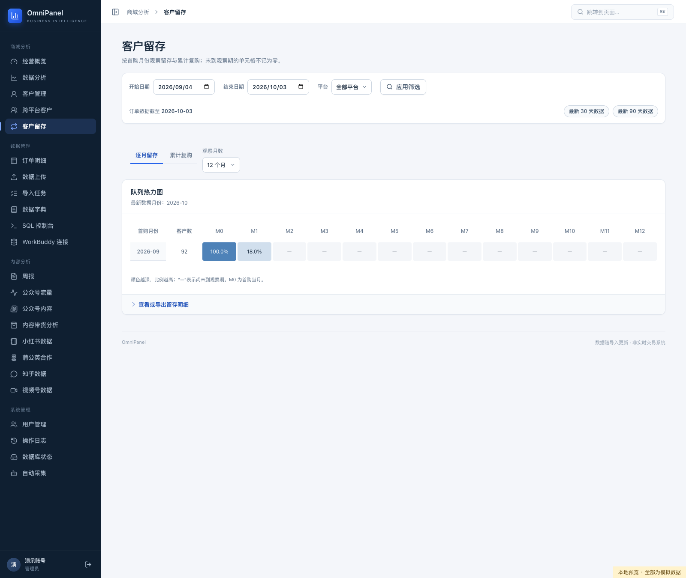 | 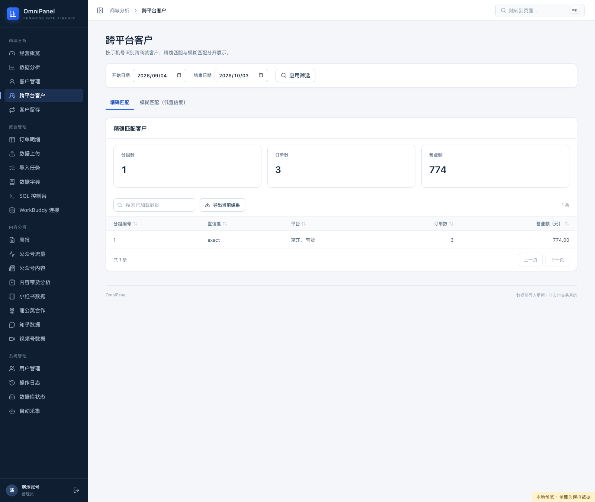 |

| SQL console | Database health |
|---|---|
| 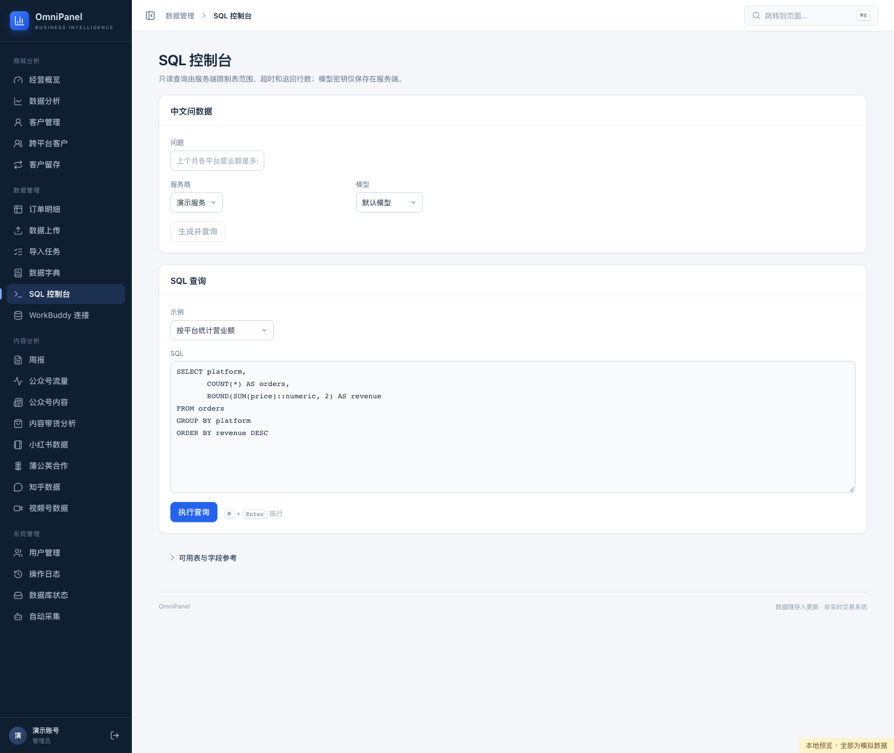 | 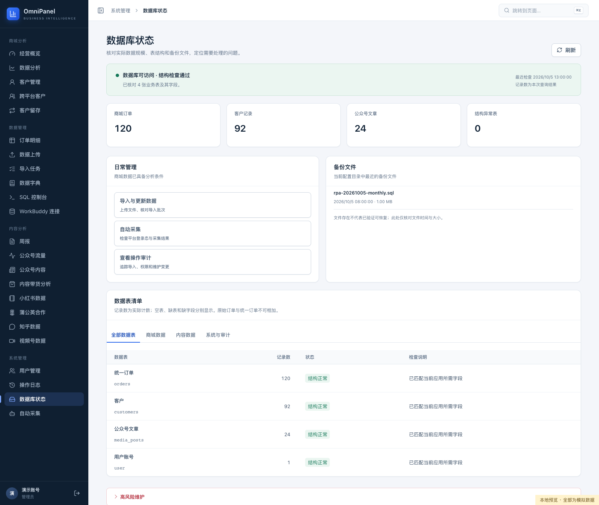 |

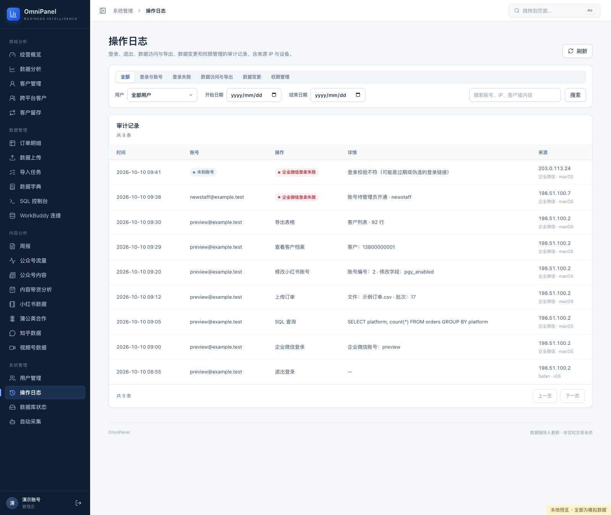

</details>

## Try the preview

Explore the interface locally with synthetic data. This preview needs **Node.js 22.18+**, with no database or Enterprise WeChat credentials.

```sh
git clone https://github.com/Nanboy-Ronan/OmniPanel.git
cd OmniPanel
npm --prefix frontend ci
npm --prefix frontend run build
node frontend/scripts/preview-fixtures.mjs
```

Open **http://127.0.0.1:5180/console/** and use the simulated sign-in. The preview serves fixture responses; uploads, authorization, and other backend operations are not a live deployment. The application interface is primarily Chinese.

## Supported platforms

| Platform | Data | Ingestion |
|---|---|---|
| Youzan · Tmall | Orders and customers | Upload platform exports |
| JD | Orders and customers | Upload exports or collect the merchant portal's rendered order list |
| WeChat Official Accounts | Articles, traffic, and followers | Scheduled API synchronization |
| Xiaohongshu | Notes, engagement, account metrics, and audience sources | Upload exports or use browser-based collection; availability varies by dataset |
| WeChat Channels · Zhihu | Content and performance | Upload exports or use browser-based collection |
| Pugongying | Creator collaborations and campaign performance | Upload exports or use browser-based collection |

Imports recognize supported column layouts and normalize records for analysis. Repeated files and orders are deduplicated; later exports can refresh order statuses. Browser collectors use authorized platform sessions and may need login renewal or updates when portal pages change. See the [collector guide](docs/collector.md).

## Self-host

The application uses **React + TypeScript**, **FastAPI**, and **PostgreSQL**. Docker Compose runs the database, migrations, API, and Nginx-served frontend.

From the repository root:

```sh
cp .env.example .env
# Configure .env before starting the application.
docker compose up --build
```

Before signing in, configure:

| Setting | Purpose |
|---|---|
| `RAP_SECRET` | A long, randomly generated authentication signing secret |
| `WECOM_CORP_ID`, `WECOM_AGENT_ID`, `WECOM_APP_SECRET` | Your Enterprise WeChat application credentials |
| `WECOM_CONSOLE_REDIRECT_URI` | Your reachable `/console/` callback URL, registered with WeCom |
| `PUBLIC_BASE_URL` | Your public deployment origin for authorization and report links |

The frontend listens on **http://localhost:5173/console/**. Real sign-in requires a WeCom-compatible callback setup; use the preview for a credential-free tour. The first authenticated user becomes an administrator; subsequent new users await approval by default.

Compose supplies its own database connection and persists database and backup volumes. For a public deployment, configure HTTPS, database credentials, and trusted proxy settings for your environment. SQL and NL-to-SQL additionally require `RAP_SQL_CONSOLE_DATABASE_URL`; without it, those query features remain disabled.

- **First installation:** [Getting started](docs/getting-started.md)
- **Existing installation:** [Upgrade notes](docs/upgrading.md)—apply migrations through `0026` before starting this version
- **All settings:** [.env.example](.env.example)

## Built to operate

Viewer, analyst, and administrator roles govern access. Audit logs cover authentication, queries, exports, and data or permission changes. Background jobs support leader election, restarts, interrupted-upload recovery, and collector health checks. Database backups include validation, retention, an optional off-site hook, and a restore-drill script.


## Documentation

| Start here | Extend and operate |
|---|---|
| [Installation and login](docs/getting-started.md) | [Architecture](docs/architecture.md) |
| [Frontend development and preview](frontend/README.md) | [Collector setup](docs/collector.md) |
| [WorkBuddy integration](docs/workbuddy-integration.md) | [WeChat synchronization](docs/wechat-auto-sync.md) |
| [Natural-language queries](docs/nl-to-sql.md) | [Maintenance and secret rotation](docs/maintenance.md) |
| [Testing with synthetic data](docs/testing.md) | [Upgrading](docs/upgrading.md) |

## Contribute

Contributions to connectors, metric definitions, tests, and the interface are welcome. Start with [CONTRIBUTING.md](CONTRIBUTING.md), or open an [issue](https://github.com/Nanboy-Ronan/OmniPanel/issues) with a reproducible example. Use synthetic fixtures and screenshots; keep credentials, real exports, and organization-specific identifiers out of contributions.

Report security issues through [SECURITY.md](SECURITY.md).

## License

[GNU Affero General Public License v3.0](LICENSE).
