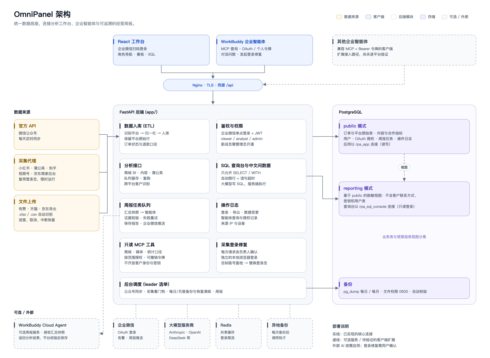

# OmniPanel

**面向经营分析与企业智能体的开源数据工作台。**

把订单、内容表现和达人合作数据汇集到一起，既能在看板中分析，也能通过 **WorkBuddy 企业智能体**按权限查询、生成周报与发起采集登录修复。数据接入、统计口径和访问审计由 OmniPanel 统一处理。

[](https://github.com/Nanboy-Ronan/OmniPanel/actions/workflows/ci.yml)
[](LICENSE)

[English](README.md) · **简体中文**

[系统框架](#系统框架) · [WorkBuddy 与其他智能体](#workbuddy-与其他企业智能体) · [体验界面](#体验界面) · [自行部署](#自行部署) · [文档](#文档)

## 最近更新

- **2026-10-17** — 加固 WorkBuddy 接入（限流、连接吊销、周报告警与重新生成），登录修复新增校验码与修复后立即采集，媒体内容按天保留指标历史并归档原始导入文件。[功能提交](https://github.com/Nanboy-Ronan/OmniPanel/commit/c51257a)
- **2026-10-14** — 新增 WorkBuddy 企业智能体接入：只读 MCP 查询、OAuth 授权、异步周报，以及负责人确认的采集登录修复。[功能提交](https://github.com/Nanboy-Ronan/OmniPanel/commit/91e7b05)
- **2026-10-10** — 更新交互界面，强化登录审批、SQL 隔离、操作审计、订单退款口径与备份恢复。[功能提交](https://github.com/Nanboy-Ronan/OmniPanel/commit/6c9e41a)
- **2026-10-05** — 迁移至 React + TypeScript 工作台，加入商城 BI、内容合作分析与数据库状态面板。[功能提交](https://github.com/Nanboy-Ronan/OmniPanel/commit/02128cb)

## 系统框架



实线表示已实现的核心连接；虚线表示可选服务或待验证的客户端扩展。外部 AI 服务按需启用，采集登录修复需要用户确认。部署细节见[架构文档](docs/architecture.zh-CN.md)。


*所有截图均使用合成演示数据。仓库不包含生产账号、凭据或真实业务导出文件。*

## 从平台报表到经营分析

OmniPanel 面向同时经营多个商城、运营多个内容账号的团队，将平台格式识别、订单归一化、重复数据处理和分析放在同一个应用中完成。

| 想了解什么 | 从哪里开始 |
|---|---|
| 销售额如何变化，哪些渠道和商品贡献最大？ | 商城看板：同期对比、渠道构成、商品排行和地区分布 |
| 哪些客户会回来，多久回来一次？ | 客户档案、月度留存队列，以及区分精确和模糊结果的跨平台匹配 |
| 哪些内容获得了阅读与互动？ | 内容分布、发布趋势、账号指标和观众来源分析 |
| 达人合作的投入与表现如何？ | 蒲公英项目和达人对比，查看费用、曝光与互动成本 |
| 这一周发生了什么？ | 商城与内容周报，保留历史报告、数据完整性提示和可选的分析摘要 |
| 如何进一步查证？ | 只读 SQL、中文问数据，或按权限开放的 WorkBuddy 查询工具 |

营业额遵循统一的订单状态与退款规则。看板分别展示数据覆盖日期和导入时间，并提示不完整的统计区间。内容带货分析用于观察关联，跨平台客户的精确与模糊匹配结果分别展示。

## WorkBuddy 与其他企业智能体

### 已实现：WorkBuddy

WorkBuddy 是 OmniPanel 的企业智能体入口，可以直接在对话中使用平台已经整理好的数据：

| 能力 | 实现方式 |
|---|---|
| 查询商城与内容表现 | 通过 MCP 获取汇总指标、媒体明细、统计口径、数据新鲜度和来源链接 |
| 按用户授权访问 | OAuth + PKCE 或个人令牌，按查询范围授权，支持撤销与审计 |
| 生成经营周报 | OmniPanel 将汇总快照交给 WorkBuddy Cloud Agent，排队执行、校验证据引用、保存报告并按配置推送 |
| 修复采集登录 | 负责人确认后启动独立本地浏览器，验证目标账号，再更新采集登录态 |

例如，可以问：“比较上周各渠道的销售表现，注明数据覆盖范围”，或“按账号分析内容表现，区分累计指标和期间新增”。只读工具不开放客户身份字段、采集凭据或任意 SQL。

[配置 WorkBuddy →](docs/workbuddy-integration.md)

### 可扩展：其他企业智能体

**可以接入，但不同能力的适配工作不同。** 当前查询服务使用 Streamable HTTP MCP，支持 Bearer 个人令牌；具备相应能力的客户端可尝试复用现有端点：

```text
https://<你的域名>/api/integrations/workbuddy/mcp
```

| 接入目标 | 当前基础与需要完成的工作 |
|---|---|
| 其他 MCP 智能体查询数据 | 复用现有工具和个人令牌；验证客户端的传输方式、请求头、Host/Origin 校验、权限与撤销行为 |
| 其他平台的一键 OAuth 连接 | 当前回调规则针对 WorkBuddy 与本地回环地址；新平台需增加精确回调规则并测试授权流程 |
| 其他智能体代替 WorkBuddy 生成周报 | 需要增加服务商适配器，保留快照、队列、证据校验与交付控制；仅支持 MCP 不等于可替换周报运行服务 |
| 其他平台执行本地登录修复 | 需要适配其本地工具或技能运行环境，保留每次授权和账号复检流程 |

尚未完成其他企业智能体产品的端到端验证，因此不将它们列为已支持平台。当前端点保留 `workbuddy` 名称；可参考[个人令牌配置模板](integrations/workbuddy/mcp.example.json)进行适配。

此外，独立的[中文问数据](docs/nl-to-sql.zh-CN.md)支持通过模型服务商生成 SQL，再使用专用只读数据库账号执行。AI 能力均需单独配置，启用后会将相应输入发送给所选服务商。

## 工作台一览

| 商城分析 | 内容表现 |
|---|---|
|  |  |

| 达人合作 | WorkBuddy 连接 |
|---|---|
|  |  |

<details>
<summary>查看客户留存、身份匹配、SQL 与运维面板</summary>

| 客户留存 | 跨平台客户 |
|---|---|
|  |  |

| SQL 查询台 | 数据库状态 |
|---|---|
|  |  |


</details>

## 体验界面

先用合成数据在本地浏览工作台。只需 **Node.js 22.18+**，无需数据库或企业微信凭据。

```sh
git clone https://github.com/Nanboy-Ronan/OmniPanel.git
cd OmniPanel
npm --prefix frontend ci
npm --prefix frontend run build
node frontend/scripts/preview-fixtures.mjs
```

打开 **http://127.0.0.1:5180/console/**，使用模拟登录进入。预览服务返回固定的演示数据，上传、授权等后台操作不代表真实部署。应用界面以中文为主。

## 支持的平台

| 平台 | 数据内容 | 接入方式 |
|---|---|---|
| 有赞 · 天猫 | 订单与客户 | 上传平台导出文件 |
| 京东 | 订单与客户 | 上传导出文件，或通过浏览器采集商家后台已展示的订单列表 |
| 微信公众号 | 文章、流量与粉丝 | 定时调用 API 同步 |
| 小红书 | 笔记、互动、账号指标与观众来源 | 上传导出文件或浏览器采集；具体能力随数据类型而异 |
| 微信视频号 · 知乎 | 内容与表现指标 | 上传导出文件或浏览器采集 |
| 蒲公英 | 达人合作与项目表现 | 上传导出文件或浏览器采集 |

导入时识别支持的列结构，将记录转换为统一的分析数据。重复文件和订单会去重，后续导出可以更新订单状态。浏览器采集使用经过授权的平台登录态；登录过期或平台页面变化时，可能需要重新登录或更新采集适配。详见[采集器文档](docs/collector.zh-CN.md)。

## 自行部署

应用使用 **React + TypeScript、FastAPI 和 PostgreSQL**。Docker Compose 包含数据库、迁移任务、API，以及由 Nginx 提供的前端。

在仓库根目录运行：

```sh
cp .env.example .env
# 先完成 .env 配置，再启动应用。
docker compose up --build
```

登录前需要配置：

| 配置项 | 用途 |
|---|---|
| `RAP_SECRET` | 足够长的随机认证签名密钥 |
| `WECOM_CORP_ID`、`WECOM_AGENT_ID`、`WECOM_APP_SECRET` | 自己的企业微信应用凭据 |
| `WECOM_CONSOLE_REDIRECT_URI` | 可访问且已在企业微信登记的 `/console/` 回调地址 |
| `PUBLIC_BASE_URL` | 对外部署域名，用于授权和报告链接 |

前端监听 **http://localhost:5173/console/**。真实登录需要配置符合企业微信要求的回调地址；无需凭据的界面体验请使用上面的预览服务。首个认证用户成为管理员，后续新增用户默认等待管理员审批。

Compose 已提供容器内数据库连接，并持久化数据库和备份卷。对外部署时，请按自己的环境配置 HTTPS、数据库凭据和可信代理。SQL 与中文问数据还需要配置 `RAP_SQL_CONSOLE_DATABASE_URL`；未配置时，这两项查询功能保持关闭。

- **首次安装：** [快速开始](docs/getting-started.zh-CN.md)
- **已有部署：** [升级说明](docs/upgrading.md)——启动本版本前，先将数据库迁移至 `0026`
- **完整配置：** [.env.example](.env.example)

## 日常运行与维护

查看者、分析员和管理员角色控制功能访问。审计日志覆盖认证、查询、导出以及数据和权限变更。后台任务支持主节点选举、异常重启、上传中断恢复和采集健康检查。数据库备份包含校验、保留策略、可选的异地复制钩子及恢复演练脚本。


## 文档

| 开始使用 | 扩展与维护 |
|---|---|
| [安装与登录](docs/getting-started.zh-CN.md) | [系统架构](docs/architecture.zh-CN.md) |
| [前端开发与合成预览](frontend/README.md) | [采集器配置](docs/collector.zh-CN.md) |
| [WorkBuddy 接入](docs/workbuddy-integration.md) | [公众号自动同步](docs/wechat-auto-sync.zh-CN.md) |
| [中文问数据](docs/nl-to-sql.zh-CN.md) | [维护与密钥轮换](docs/maintenance.zh-CN.md) |
| [合成数据测试](docs/testing.zh-CN.md) | [版本升级](docs/upgrading.md) |

## 参与贡献

欢迎改进平台适配、统计口径、测试和界面。请先阅读[贡献指南](CONTRIBUTING.md)，或通过 [Issue](https://github.com/Nanboy-Ronan/OmniPanel/issues) 提交可复现的例子。贡献中的样例与截图请使用合成数据，不要提交凭据、真实导出文件或组织专属标识。

安全问题请按 [SECURITY.md](SECURITY.md) 中的方式报告。

## 许可证

[GNU Affero General Public License v3.0](LICENSE)。
